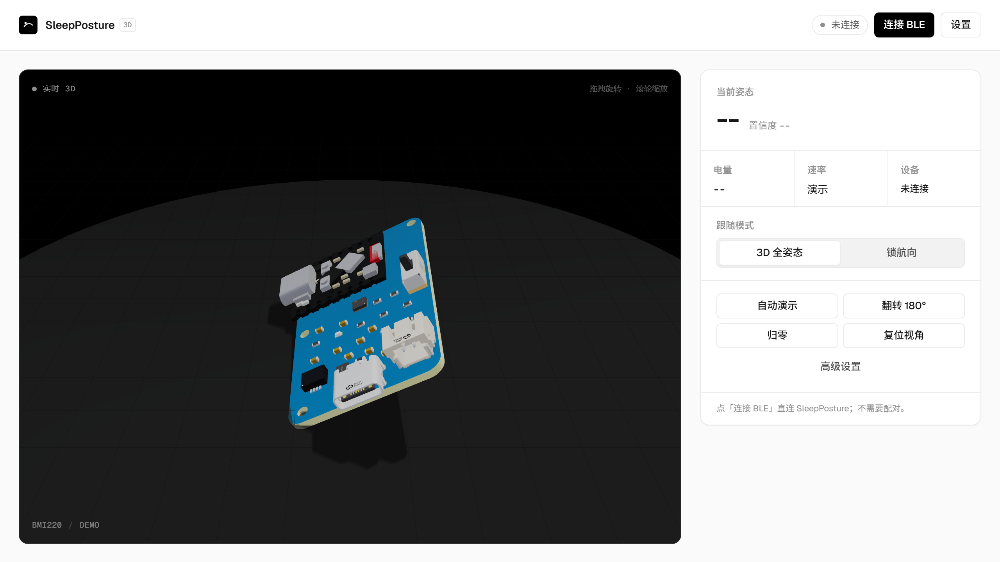
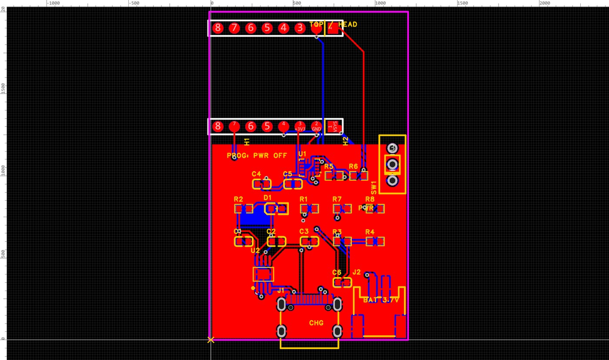
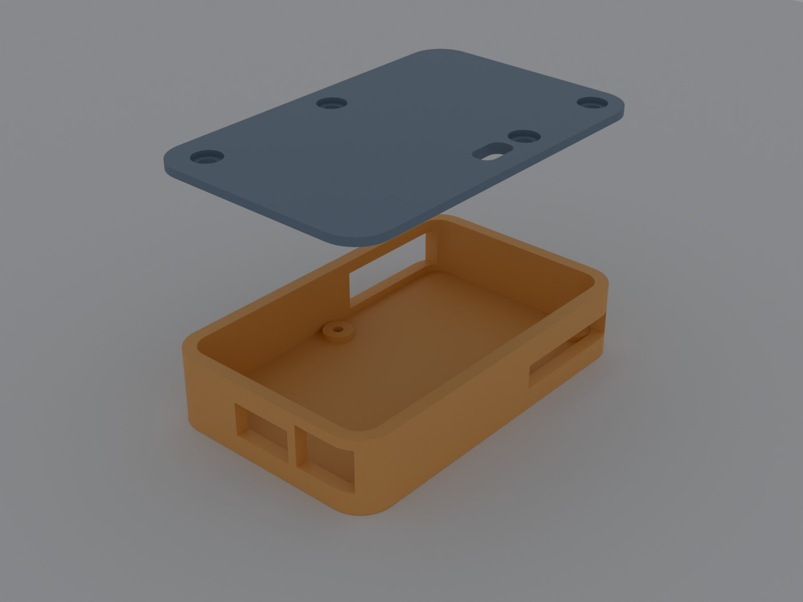

<div align="center">

# SleepPosture

**胸骨 IMU · ESP32-C3 · BLE · 实时 3D 睡姿监测**

仰卧 / 俯卧 / 左侧卧 / 右侧卧，25 Hz 无线姿态数据流。

[在线 3D 演示](https://sleep-posture-3d.vercel.app) ·
[硬件](hardware/) ·
[固件](firmware/) ·
[Web 应用](tools/visualizer-react/) ·
[文档](docs/)




</div>

## 它是什么

一枚贴在胸骨（或上腹部）的 IMU，通过 BLE 把加速度、角速度和姿态结果送到浏览器。网页用 **Web Bluetooth 直连**，实时渲染板子的 3D 姿态；不需要手机 App，也不需要 Python 桥接。

- **四种睡姿**：仰卧 / 俯卧 / 左侧卧 / 右侧卧，另有「翻身/过渡」和「未知」，避免强行归类污染数据。
- **50 Hz 采样，25 Hz 推流**：C3 内部保持 50 Hz；默认 25 Hz BLE 通知在 Windows Chrome 下更稳（实测 60 s 1,500/1,500 帧）。
- **可穿戴结构**：刚性 PCB + 硅胶导线 + 弹性胸带，不使用 FPC/软板。
- **可解释分类**：重力矢量阈值 + 迟滞状态机；机器学习只做离线对照。
- **实时可视化**：3D 全姿态 / 锁航向、自动重连、断流冻结、方向校准。

## 当前状态

| 模块 | 状态 |
|---|---|
| 硬件 | 首板已手装上电；Gerber / BOM / CPL 可下单；充电、外壳、整夜采集未验证 |
| 固件 | BMI220 / BMI270 / LSM6DS3TR-C 自动探测；50 Hz 采样；25 Hz BLE 稳定 |
| Web | Vercel 已部署；Web Bluetooth 直连；25 Hz 实测 1,500/1,500 帧，0 CRC / 0 丢帧 |
| 验证 | 平放（supine）99%；俯卧 / 左 / 右四点、整夜 M2 尚未测试 |

## 技术栈

| 层 | 技术 |
|---|---|
| 硬件 | ESP32-C3 SuperMini · BMI220 / BMI270 · TP4056 · TPS63031 · EasyEDA |
| 固件 | ESP-IDF · NimBLE · I2C |
| Web | Next.js 16 · React 19 · Tailwind CSS · three.js · Web Bluetooth |
| 部署 | Vercel |

## 硬件

当前载板 **30.7 × 50.8 mm**，1.0 mm 两层板，四角 R3，4× M2 装配孔；TP4056 充电 + TPS63031 3.3 V 升降压，I2C IMU 放在板中心。

| PCB | 外壳 |
|:---:|:---:|
|  |  |

- [硬件索引](hardware/README.md) · [Gerber / BOM / CPL](hardware/gerber-tp4056/) · [设计说明](hardware/docs/) · [当前 EasyEDA 工程](hardware/supermini-carrier-full-tp4056/)
- 首板实测 IMU 为 **BMI220**（WHO_AM_I `0x26`）；BMI270（`0x24`）与 LSM6DS3TR-C 备用，固件自动识别。
- 电池必须带保护板；整机使用 602535 500 mAh 软包，电池放侧袋，远离天线。

## 固件

ESP-IDF 工程，上电初始化 I2C、自动探测 IMU、运行 50 Hz 采样与姿态分类；BLE 提供 24 字节数据帧、12 字节状态帧和控制命令。

```bash
cd firmware
idf.py build
idf.py -p COMx flash monitor
```

- 协议：[protocol/ble-protocol.md](protocol/ble-protocol.md)
- 构建与烧录：[firmware/README.md](firmware/README.md)
- BLE 默认 **25 Hz**（`0x01 0x19`，`notify_div=2`）；50 Hz 在 Windows Web Bluetooth 下会持续丢通知。

## Web 应用

Next.js + three.js 的实时 3D 页面，Web Bluetooth 直接连接板子：

```bash
cd tools/visualizer-react
npm install
npm run dev
```

打开 <http://localhost:3000>，点「连接 BLE」，在 Windows 弹窗里选 **SleepPosture → Pair**。

- 在线版：<https://sleep-posture-3d.vercel.app>
- 3D 全姿态 / 锁航向、拖拽旋转、滚轮缩放
- 3 步方向校准：平放 → 抬 HEAD → 抬右手边
- 自动重连、无数据看门狗、断流冻结
- 没有蓝牙适配器时会直接提示，不再“点了没反应”
- 使用系统 Chrome / Edge；内置预览窗没有完整的蓝牙选择器

## 仓库结构

```text
.
├─ firmware/                 ESP-IDF 工程
├─ hardware/
│  ├─ supermini-carrier-full-tp4056/   当前 EasyEDA 工程
│  ├─ gerber-tp4056/                   当前下单文件
│  ├─ enclosure-tp4056/                当前外壳
│  ├─ docs/                            硬件设计说明
│  └─ bom-*.csv                        载板 / 原型 / v1 BOM
├─ protocol/                 BLE GATT 与帧格式
├─ tools/
│  ├─ ble/                   BLE 采集与离线评估
│  └─ visualizer-react/      当前 Next.js + Web Bluetooth 应用
├─ docs/                     计划、选型、验证、bring-up
└─ data/                     本地采集数据
```

## 文档

- [原型计划](docs/prototype-plan.md) · [器件选型](docs/component-selection.md) · [验证规程](docs/validation-protocol.md)
- [上电检查清单](docs/bring-up-checklist.md) · [下单检查清单](docs/pre-order-checklist.md)
- [BLE 协议](protocol/ble-protocol.md)

## 里程碑

| 阶段 | 目标 |
|---|---|
| M0 桌面原型 | 连续 30 min BLE 推流，CRC < 0.1% |
| M1 静态四点 | 稳态时间加权准确率 ≥ 95%，unknown < 5% |
| M2 整夜 3 晚 | 稳态准确率 ≥ 85%，macro-F1 ≥ 0.80，仰卧 ≥ 90%，俯卧 ≥ 65%，左/右 ≥ 80% |
| M3 刚性板 v1 | 3 晚无断线、无压迫，指标不低于 M2 |

## 安全

这是个人睡眠研究原型，不是医疗器械，不用于诊断或治疗。

- 带子不要勒紧；皮肤压迫、麻木或呼吸不适时立即停止。
- 电池必须带保护板；不要戴着设备充电；鼓包立即停用。
- 数据默认只存本地，不根据姿态结果做医疗或睡眠质量结论。
